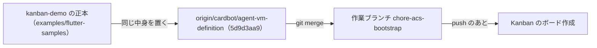
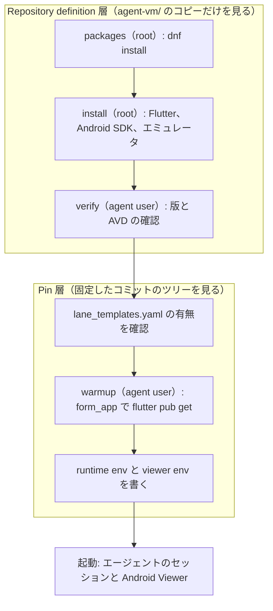

# 000 Kanban 対応: Agent VM イメージ定義とレーン定義の取り込み

## 背景 (Background)

### Kanban が対象リポジトリに求めるもの

Kanban のボードは、対象リポジトリ用に作った Agent VM の上でコーディングエージェントを動かす。Agent VM のイメージは次の 3 層でできている（kanban-demo の `docs/target-repo-agent-vm-image.md`）。

| 層 | 中身 | 作り直す契機 |
| :--- | :--- | :--- |
| Platform（Kanban が持つ） | Amazon Linux 2023、agent-runner、tt、起動の台本、共通の道具、Android Viewer のサービス | Kanban の Platform の定め（recipe）が変わったとき |
| Repository definition（本リポジトリが持つ） | `image.yaml` の `packages`、`install/`、`verify/` | `image.yaml`・`install/`・`verify/` が変わったとき |
| Pin（ボードごと） | 固定したコミットのツリー、`warmup/`、実行時の環境変数 | 固定するコミットが変わるたび |

Platform 層にはリポジトリ固有のものが入らない。Flutter SDK、Android SDK、エミュレータは、本リポジトリが `.kotoshiro/kanban/agent-vm/` に定義として書く必要がある。

### 本リポジトリの現状と困ること

- `main` と作業ブランチ（`chore-acs-bootstrap`）には `.kotoshiro/kanban/` が無い。
- Kanban の Pin 層の bake（kanban-demo の `scripts/infra-aws3/agent-vm/builder/bake_pin_layer.sh`）は、固定したコミットに `.kotoshiro/kanban/lane_templates.yaml` が無いとエラーで止まる。このため、今の作業ブランチを対象にしたボードは作れない。
- `agent-vm/` が無い場合、Kanban は Platform 層の上に Pin 層だけを重ねる。その VM には Flutter も Android SDK も無く、Android Viewer は「イメージが対応していない」と表示する。

### 既にある定義

調査の結果、定義は既に 2 か所にある。

1. kanban-demo の正本: `scripts/infra-aws3/agent-vm/examples/flutter-samples/`（kanban-demo のコミット `6681859`、2026-11-27）。kanban-demo の文書は、ここを正本（canonical copy）と定めている。
2. 本リポジトリのリモートブランチ `origin/cardbot/agent-vm-definition`: コミット `5d9d3aa9`（2026-11-27、親は `main` の `a5bccd24`）。`.kotoshiro/kanban/` の 7 ファイルを足すだけのコミットである。

両者の Git オブジェクト ID を比べた結果、`agent-vm/` の 6 ファイルはバイト単位で一致した。ファイルモードも同じで、blob に CR は含まれない。

| ファイル（`.kotoshiro/kanban/` 配下） | blob ID | モード | 正本との関係 |
| :--- | :--- | :--- | :--- |
| `agent-vm/image.yaml` | `7e443ece` | 100644 | 一致 |
| `agent-vm/install/10-flutter-sdk.sh` | `44e18e8b` | 100755 | 一致 |
| `agent-vm/install/20-android-sdk.sh` | `77e9f82b` | 100755 | 一致 |
| `agent-vm/install/30-emulator.sh` | `1d29cdb7` | 100755 | 一致 |
| `agent-vm/verify/10-flutter-doctor.sh` | `a642cb9d` | 100755 | 一致 |
| `agent-vm/warmup/10-pub-get.sh` | `7ba8048d` | 100755 | 一致 |
| `lane_templates.yaml` | `b477a860` | 100644 | 正本に無い（本リポジトリだけが持つ） |

Kanban 側の試験の fixture（kanban-demo の `scripts/infra-aws3/test/fixtures/agent_vm_image_keys.tsv`）も、このコミット `5d9d3aa9` を参照している。

取り込む `image.yaml` は次のとおりである。

```yaml
version: 1
board_defaults:
  backend: ec2
  instance_type: m8i.2xlarge
  android_viewer: true
builder:
  instance_type: m8i.xlarge
  root_volume_gib: 100
  timeout_minutes: 60
packages:
  dnf: [unzip, which, xz, tar, git, java-17-amazon-corretto-devel]
runtime:
  env:
    FLUTTER_ROOT: /opt/toolchains/flutter
    ANDROID_HOME: /opt/toolchains/android-sdk
    ANDROID_SDK_ROOT: /opt/toolchains/android-sdk
    JAVA_HOME: /usr/lib/jvm/java-17-amazon-corretto
    PUB_CACHE: /var/cache/cardbot/agent-vm/pub-cache
  path_prepend:
    - /opt/toolchains/flutter/bin
    - /opt/toolchains/android-sdk/platform-tools
integrations:
  android_viewer:
    avd: cardbot
    flutter_app_dir: form_app
```

（先頭の 3 行のコメントは省いた。）

### 定義ハッシュとイメージの再利用

Kanban は Repository definition 層を次の値で識別する（kanban-demo の `scripts/infra-aws3/lib/agent_vm_image.sh` の `agent_vm_image_definition_hash`）。

```text
sha256("image.yaml=<blob ID>|install=<tree ID>|verify=<tree ID>")
```

`5d9d3aa9` での値は `08d135fe9c9fb355d2c9028cd65039d072dff675b37de46f60e451a5c82ef82d` である（install の tree は `be8e772c`、verify の tree は `075c0f53`）。この層のイメージの key は `layer=repo|format=…|arch=…|recipe=…|definition=<この値>` で、同じ key の AMI があれば、Kanban は新しく作らずに再利用する（`147_agent_vm_image.sh` が `reused=1` を返す）。

したがって、本リポジトリの定義を正本とバイト単位で同じに保てば、Platform の recipe が同じ間は `cardbot/agent-vm-definition` のボードと Repository definition 層の AMI を共有できる。Flutter と Android SDK を入れ直す bake（`builder.timeout_minutes` は 60 分）を省ける。tree ID はファイルモードも含むので、中身が同じでもモードが変わればハッシュは変わる。

### パッケージの要件（層ごと）

Platform 層（kanban-demo の `scripts/infra-aws3/agent-vm/platform/provision.sh`）が入れるもの:

| 用途 | パッケージ・部品 |
| :--- | :--- |
| 共通の道具 | `git` `python3` `python3-pyyaml` `tar` `gzip` `unzip` `xz` `which` `findutils` |
| Android Viewer と画面 | `tigervnc-server` `libX11` `libXext` `libXrandr` `libXrender` `libXi` `libXcursor` `libXfixes` `mesa-libGL` `mesa-libEGL` `libusb1` `pulseaudio-libs` `gperftools-libs`、scrcpy、guacd |
| その他 | `docker` `amazon-cloudwatch-agent`、agent-runner、tt、起動の台本と systemd の unit、定義の runner と helper、KVM の設定 |
| 入れられれば入れる | `ffmpeg-free` `android-tools` `sdl2-compat` |

Repository definition 層（本リポジトリの定義）が入れるもの:

| フェーズ | ファイル | 入れるもの |
| :--- | :--- | :--- |
| packages | `image.yaml` | `unzip` `which` `xz` `tar` `git` `java-17-amazon-corretto-devel`。JDK 17 は Gradle・AGP・sdkmanager が使う。前の 5 つは Platform 層と重なるが、dnf は入れ済みのパッケージには何もしないので害は無い |
| install | `10-flutter-sdk.sh` | Flutter 3.50.1（revision `ae9b586f…`、tarball の sha256 を照合）を `/opt/toolchains/flutter` に置き、`flutter precache --android` を流す |
| install | `20-android-sdk.sh` | cmdline-tools（sha1 を照合）を置き、ライセンスに同意し、`platform-tools` `platforms;android-36` `build-tools;36.0.0` `ndk;28.2.13676358` を `/opt/toolchains/android-sdk` に入れる |
| install | `30-emulator.sh` | Platform の helper（`android-emulator-install`）で `emulator` と `system-images;android-35;google_apis;x86_64` を入れ、AVD `cardbot` を `/var/lib/cardbot/avd` に作る |
| verify | `10-flutter-doctor.sh` | Flutter の版、`adb`、エミュレータ本体、AVD の設定ファイルを確かめる。`flutter doctor -v` の結果では失敗にしない |

Pin 層では `warmup/10-pub-get.sh` が `form_app` で `flutter pub get` を流し、`PUB_CACHE` に依存を貯める。`form_app` は `resolution: workspace` なので、この 1 回でルートの workspace の全 37 メンバーの依存が解決される。

### Flutter 3.50.1 との整合

| 確かめたこと | 結果 | 出どころ |
| :--- | :--- | :--- |
| 3.50.1 は今の stable か | stable の最新（2026-11-20 公開）。revision と sha256 は `10-flutter-sdk.sh` の値と一致する | Flutter の公開リリース一覧 `releases_linux.json` |
| 同梱の Dart とリポジトリの SDK 制約 | Dart 3.14.0。workspace の全 37 メンバーの `environment.sdk: ^3.14.0-0` を満たす。`environment.flutter` を持つメンバーは無い | 同上、各 `pubspec.yaml` |
| Android SDK の版 | Flutter 3.50.1 の既定は compileSdk 36・targetSdk 36・minSdk 24・NDK `28.2.13676358`。`20-android-sdk.sh` の版と一致する | Flutter 3.50.1 の `FlutterExtension.kt` |
| Java の版 | Flutter 3.50.1 は Gradle を動かす Java が 17 未満だと止める。JDK 17（Corretto）で満たす | Flutter 3.50.1 の `DependencyVersionChecker.kt` |
| Gradle・AGP・Kotlin の最小版 | Gradle 9.3.1・AGP 9.1.1・Kotlin Gradle Plugin 2.4.10 未満を例外で止める。警告は 9.5.0・9.3.1・2.4.20 未満 | 同上 |

### 調査で分かった問題

1. **`form_app` の Android 構成が古い（定義の外の問題）**
   `form_app/android` は Gradle 7.5・AGP 7.3.0・Kotlin 1.7.10 の Groovy DSL で、Flutter 3.50.1 の最小版をすべて下回る。Flutter のソースを読む限り、`flutter run` や `flutter build apk` はこの検査で例外終了する（実行しての確認はしていない）。上流は Android の CI を `if: false` で止めており（`.github/workflows/build-android.yml`）、ほかのサンプルも最新で AGP 8.9.1・Gradle 8.12（`cupertino_gallery`）と、最小版を満たさない。
   Kanban のカード 3 件（`origin/card/card-5a6b714a…`、`card-5da6a2b0…`、`card-d1c5cae7…`）は、どれも `form_app/android` を新しいテンプレートで作り直していた（Gradle 9.5.0 への更新と、`gradle.properties` に「Flutter template が足した」と注記された行がある）。ただし、カードの自動コミットに入っているのは Groovy の build ファイルの削除と既存ファイルの変更だけで、新しいテンプレートが作るはずの `.kts` ファイルは入っていない。このため、カードのブランチの Android 構成は欠けた状態で残っている。自動コミットが未追跡ファイルを含めないためと推定する（Kanban 側の問題で、本仕様では扱わない）。
   イメージの bake は `flutter pub get` までなので、この問題では止まらない。一方、Flutter dev supervisor は `form_app` で `flutter run --machine -d emulator-5554 --debug` を実行するので、Viewer の Hot Reload・Hot Restart・Rebuild は失敗する見込みである。扱いは `backlog:9710627d-5ac1-4ac1-b800-9a52889b1df0` で決める。
2. **Flutter の前提パッケージの一部が無い**
   Flutter の手動インストール手順は、Linux の前提として `curl` `git` `unzip` `xz-utils` `zip` `libglu1-mesa` を挙げる。このうち `zip` と GLU に当たるものが、Platform 層にも定義にも無い。影響は確かめていない。扱いは `backlog:494ae8fa-b3eb-44be-a393-fd5c8fb7fffe` で決める。
3. **Windows の作業コピーで改行が CRLF になる**
   `.gitattributes` は `*.sh text` だけで、展開時の改行（`eol`）を決めていない。この開発機は `core.autocrlf=true` なので、取り込むと作業コピーの `.sh` は CRLF になる。リポジトリの blob は LF のままなので Kanban の bake には影響しない。しかし、手元で bash に読ませる確認（`bash -n` や Kanban の runner の試験モード）は `$'\r'` で失敗する。
4. **標準のビルドと試験は何も確かめない**
   ACS で取り込んだ `scripts/process/build.sh` は `features/*/go.mod` だけを扱うので、本リポジトリでは何もせずに成功する。`scripts/process/integration_test.sh` も `tests/go.mod` が無いので何も流さない。このままでは定義を壊しても、標準の手順では気付けない。
5. **上流に追従すると bake が止まりうる**
   上流は Flutter のリリースごとに SDK の制約を上げる。たとえば `main` の `12a19162`（Flutter 3.50 release）は、`pubspec.yaml` の `sdk` の制約を `^3.9.0-0` などから `^3.14.0-0` に上げた（38 か所）。次のリリースで制約が `^3.15.0-0` になったものを `main` から取り込むと、イメージの Flutter（Dart 3.14.0）では warmup の `flutter pub get` が解決できない。その結果、Pin 層の bake が止まり、ボードを作れなくなる。

## 要件 (Requirements)

### 必須要件

- **R1 取り込み**: 作業ブランチに `origin/cardbot/agent-vm-definition`（`5d9d3aa9`）の 7 ファイルを取り込む。中身とファイルモードは `5d9d3aa9` と同じにする。
- **R2 正本と同じに保つ**: `.kotoshiro/kanban/agent-vm/` の中身は kanban-demo の正本とバイト単位で同じに保ち、定義ハッシュを `08d135fe…` にする。定義を変えるときは、先に kanban-demo の正本を直し、それを本リポジトリへ取り込む。本リポジトリの側だけで直さない。
  - `lane_templates.yaml` には正本が無いので、本リポジトリが持ち主になる。`lane_templates.yaml` は定義ハッシュに入らない。
- **R3 改行**: Windows の作業コピーでも `.sh` を LF で展開する。
- **R4 検査スクリプト**: 次を確かめる検査を作り、`scripts/process/build.sh` から毎回流す。
  1. **置き場所**: `.kotoshiro/kanban/lane_templates.yaml` と `.kotoshiro/kanban/agent-vm/image.yaml` がある。`lane_templates.yaml` は YAML として読め、`version: 1` と空でない `templates` を持つ。
  2. **`image.yaml` の決まり**（kanban-demo の文書の Validation に合わせる）:
     - `version` が 1 である。
     - 知らない key が無い。知っている key は、最上位が `version` `board_defaults` `builder` `packages` `runtime` `integrations`、`board_defaults` が `backend` `instance_type` `android_viewer`、`builder` が `instance_type` `root_volume_gib` `timeout_minutes`、`packages` が `dnf`、`runtime` が `env` `path_prepend`、`integrations` が `android_viewer`、`android_viewer` が `avd` `flutter_app_dir` である。
     - `builder.timeout_minutes` が 180 以下である。
     - `packages.dnf` の各要素が素のパッケージ名（`^[A-Za-z0-9][A-Za-z0-9._+-]*$`）である。
     - `runtime.env` の key が変数名（`^[A-Za-z_][A-Za-z0-9_]*$`）である。`_ROOT`・`_HOME`・`_DIR`・`PATH` で終わる key の値と、`path_prepend` の各要素が絶対パスである。
     - `integrations.android_viewer.flutter_app_dir` がリポジトリ内の相対パスで、その場所に `pubspec.yaml` がある（`pubspec.yaml` の有無は、Viewer がそこで `flutter` を動かすため本リポジトリで足す確認）。
     - `builder.instance_type` が Kanban の catalog にあるかは確かめない。catalog は本リポジトリから見えず、CreateBoard が確かめるためである。
  3. **台本**: `install/`・`verify/`・`warmup/` の直下の `*.sh` が、作業コピーで CR を含まず、`bash -n` を通る。
  4. **定義ハッシュ**: コミットされる中身（作業コピーを index に載せたもの）から Kanban と同じ式で計算し、期待値 `08d135fe…` と一致する。計算した値を表示する。
  5. **SDK の互換**: `install/10-flutter-sdk.sh` の Flutter の版と、`verify/10-flutter-doctor.sh` が確かめる版が同じである。その Flutter に同梱の Dart（3.50.1 なら 3.14.0）が、ルートの `pubspec.yaml` と、その `workspace` に並ぶ全メンバーの `environment.sdk` を満たす。`environment.flutter` があれば、Flutter の版がそれも満たす。
  6. **失敗の扱い**: 違反したファイルと決まりをすべて出し、終了コード 1 で終わる。前提が欠けたときに検査を飛ばさない。`python3` か PyYAML が無ければ失敗にする。
- **R5 検査の自己試験**: 検査が壊れた定義を見逃さないことを、一時的な Git リポジトリで確かめる試験を作り、`scripts/process/build.sh` から流す。正常の 1 件と、検証シナリオ 5 に挙げた壊し方をすべて含める。
- **R6 触らない範囲**: Flutter のサンプルのコード（`form_app` を含む）は変えない。本仕様で変える上流のファイルは `.gitattributes`（末尾への追記）だけにする。

### 任意要件

- **O1 正本との突き合わせ**: kanban-demo の checkout を引数で渡したときだけ、次も確かめるモードを持つ。
  - 正本の 6 ファイルと、本リポジトリの 6 ファイルがバイト単位で一致する。
  - Kanban の runner（kanban-demo の `scripts/infra-aws3/agent-vm/runner/run_definition.sh`）を試験モードで動かし、`packages` の計画と、`--write-runtime-env`・`--write-viewer-env` の出力が期待どおりである。
  - このモードは既定の検査に含めない。既定の検査が飛ばすのではなく、別のモードとして明示して呼ぶ。

### 対象外

- `form_app` の Android 構成の移行と、Gradle の依存の事前取得（`backlog:9710627d-5ac1-4ac1-b800-9a52889b1df0`）。
- 前提パッケージ `zip` と GLU の追加。正本の側で決める（`backlog:494ae8fa-b3eb-44be-a393-fd5c8fb7fffe`）。
- `lane_templates.yaml` のレーンへの ACS のタグ（`acsTags`）の付与（`backlog:07d507dc-651b-41f8-a781-99abde97d2cf`）。
- ACS のテンプレート（Go 向けの `coding-rules` や `testing-rules` など）を Flutter 向けに直すこと。
- このフォークの GitHub Actions で検査を流すこと。
- push と PR。ユーザーが指示したときに行う。

## 実現方針 (Implementation Approach)

### 全体の流れ



Kanban がボードを作るときの流れと、取り込むファイルが動く場所は次のとおりである。



### 1. 取り込みには merge を使う

作業ブランチで `git merge origin/cardbot/agent-vm-definition` を行う。ファイルのコピーや cherry-pick ではなく merge を選ぶ理由は次のとおりである。

- コミット `5d9d3aa9` そのものが履歴に入る。`cardbot/agent-vm-definition` が後で更新されても、同じブランチをもう一度 merge すれば追従できる。
- blob、tree、ファイルモード（100755）がそのまま入る。Windows（`core.filemode=false`）でファイルを新しく作ると、モードが 100644 になり、tree ID と定義ハッシュが正本と変わってしまう。merge ならこの問題が起きない。
- 作業ブランチの未追跡ファイル（ACS の取り込み分。`.kotoshiro/tokotachi/downloaded.yaml` を含む）と、取り込むパスは重ならない。

merge の前に `git fetch origin` を行い、`origin/cardbot/agent-vm-definition` が `5d9d3aa9` のままかを確かめる。進んでいた場合は、正本と一致するかを O1 のモードか定義ハッシュで確かめてから取り込む。

### 2. 改行: `.gitattributes` の末尾に追記する

```gitattributes
# Shell scripts run with bash on Linux (Kanban Agent VM, scripts/); keep LF on checkout.
*.sh text eol=lf
```

上流の行（`*.sh text`）は書き換えず、末尾に足す。gitattributes では同じ属性について後の行が優先されるので、`.sh` の扱いは `text eol=lf` になる。blob は既に LF なので、定義ハッシュは変わらない。属性を足しただけでは既にある作業コピーは変わらないので、取り込んだ `.sh` を checkout し直して LF にする。

### 3. 検査スクリプトの構成

| ファイル | 役割 |
| :--- | :--- |
| `scripts/process/check_kanban_definition.sh` | 入口。Git から blob と tree の ID を取って定義ハッシュを計算し、台本の CR と `bash -n` を確かめ、Python の検査を呼ぶ。`--repo-root DIR` で対象のリポジトリを替えられる（既定は Git の最上位）。O1 のモードは `--kanban-demo DIR` |
| `scripts/process/lib/kanban_definition_check.py` | `image.yaml`・`lane_templates.yaml`・各 `pubspec.yaml` を PyYAML で読み、R4 の 1・2・5 を確かめる |
| `scripts/process/test/check_kanban_definition_test.sh` | R5 の自己試験 |

期待値は入口のスクリプトに定数で持つ。

```bash
EXPECTED_DEFINITION_HASH=08d135fe9c9fb355d2c9028cd65039d072dff675b37de46f60e451a5c82ef82d
```

Flutter の版と同梱の Dart の版の対応も、Python の側に表で持つ。初めは「Flutter 3.50.1 には Dart 3.14.0」の 1 行だけである。表に無い版が定義に書かれたら失敗させ、Flutter の `releases_linux.json` を見て表に足すよう案内する。正本を更新して版を上げるときは、期待値と表を同じ変更で直す。

**定義ハッシュの計算**: Kanban はコミットの Git オブジェクトから計算する。手元では未コミットの変更も確かめたいので、一時的な index を使う。

1. `GIT_INDEX_FILE` に一時ファイルを指定し、`git read-tree HEAD` で HEAD と同じ index を作る。HEAD のファイルモード（100755）を引き継ぐためである。
2. `git add -A -- .kotoshiro/kanban/agent-vm` で作業コピーを載せる。`text` 属性による改行の正規化もここで効くので、コミットされる blob と同じになる。
3. `git write-tree` で得た tree から、`image.yaml` の blob ID と `install`・`verify` の tree ID を取る。`printf 'image.yaml=%s|install=%s|verify=%s'` の出力（改行なし）を `sha256sum` に通す。

**Windows の Git Bash での注意**:

- `git rev-parse "<rev>:<path>"` の引数は MSYS のパス変換で壊れるので、`MSYS_NO_PATHCONV=1` を付けて呼ぶ（調査中に実際に壊れた）。ただし、付けるのは git の呼び出しだけにする。全体に export すると、Windows 版の Python や Kanban の runner へ渡すパスの自動変換まで止まってしまう。
- Windows 版の Python には、リポジトリ相対のパスを渡す。`/tmp` などの MSYS のパスは Windows 版の Python からは見えない。
- 一時ディレクトリはリポジトリの `tmp/`（gitignore 済み）の下に作り、終わったら消す。

**結果の出し方**: Kanban の runner の書式に合わせ、違反ごとに `kanban_definition_check_failed rule=<決まり> file=<ファイル> detail=<内容>` を 1 行出す。最後の行は `kanban_definition_check_ok definition=<hash>` か `kanban_definition_check_failed count=<件数>` にする。

### 4. `build.sh` への組み込み

`scripts/process/build.sh` の `main` で、`build_go` の後に `check_kanban_definition`（検査と自己試験を流す関数）を呼ぶ。失敗したら `FAILED=true` にして、パイプライン全体を失敗で終える。ヘルプの説明にも、この検査を足す。

### 5. O1 のモード

`scripts/process/check_kanban_definition.sh --kanban-demo <kanban-demo の checkout>` のとき、R4 に加えて次を行う。

- 正本の 6 ファイルと本リポジトリの 6 ファイルを `cmp` で比べる。
- `AGENT_VM_RUNNER_TEST_MODE=1` で runner を動かす。`--log-dir` は `tmp/` の下を指す。
  - `--phase packages` の出力が `would install: unzip which xz tar git java-17-amazon-corretto-devel` である。
  - `--write-runtime-env` の出力に `FLUTTER_ROOT=/opt/toolchains/flutter`、`ANDROID_HOME=/opt/toolchains/android-sdk`、`PATH=/opt/toolchains/flutter/bin:/opt/toolchains/android-sdk/platform-tools:/usr/local/sbin:` で始まる行がある。
  - `--write-viewer-env` の出力に `AVD_NAME=cardbot` と `FLUTTER_APP_DIR=form_app` がある。
- `--kanban-demo` に渡したディレクトリに正本や runner が無ければ失敗にする。

## 検証シナリオ (Verification Scenarios)

1. 作業ブランチで `git fetch origin` を行い、`origin/cardbot/agent-vm-definition` が `5d9d3aa9` であることを確かめる。
2. `git merge origin/cardbot/agent-vm-definition` を行う。`git ls-tree -r HEAD -- .kotoshiro/kanban` の blob ID とモードが、「既にある定義」の表と一致する。
3. `.gitattributes` に追記し、取り込んだ `.sh` を checkout し直す。作業コピーの `.sh` に CR が無い。
4. `scripts/process/build.sh` を流す。Kanban 定義の検査が `kanban_definition_check_ok definition=08d135fe9c9fb355d2c9028cd65039d072dff675b37de46f60e451a5c82ef82d` を出し、自己試験も通り、`build.sh` が成功で終わる。
5. 自己試験の中で、一時的な Git リポジトリに定義を写して壊し、検査がそれぞれ失敗することを確かめる。
   1. `install/20-android-sdk.sh` に CRLF を混ぜると、`rule=crlf` で失敗する。
   2. `image.yaml` に知らない key（例: `extra: 1`）を足すと、`rule=unknown-key` で失敗する。
   3. `flutter_app_dir` を無いディレクトリにすると、`rule=flutter-app-dir` で失敗する。
   4. workspace のメンバーの `environment.sdk` を `^3.15.0-0` にすると、`rule=sdk-constraint` で失敗する（Dart 3.14.0 では満たせない）。
   5. 台本を 1 バイト変えると、`rule=definition-hash` で失敗する。
   6. 台本のモードを 100644 にすると、`rule=definition-hash` で失敗する。
   7. `lane_templates.yaml` を消すと、`rule=lane-templates` で失敗する。
   8. `builder.timeout_minutes` を 181 にすると、`rule=builder-timeout` で失敗する。
6. （O1）kanban-demo の checkout を渡して検査を流し、正本とのバイト一致と、runner の試験モードの出力が期待どおりであることを確かめる。
7. （ユーザーが行う受け入れ）ユーザーの指示で作業ブランチを push し、Kanban でこのブランチを対象にボードを作る。CreateBoard に定義の要約が出る。Repository definition 層は再利用される（`reused=1`）か、bake が成功する。verify のログの最後に `flutter toolchain ok`、warmup のログの最後に `form_app packages cached` が出る。Android Viewer が使える状態になる。Hot Reload と Rebuild は `backlog:9710627d-5ac1-4ac1-b800-9a52889b1df0` が片付くまで失敗する見込みなので、この受け入れには含めない。

## テスト項目 (Testing for the Requirements)

| 要件 | 確かめ方（自動） |
| :--- | :--- |
| R1 | 定義ハッシュの一致（R4-4）で、`agent-vm/` の 6 ファイルの中身とモードが `5d9d3aa9` と同じだと分かる。`lane_templates.yaml` は R4-1 で確かめる |
| R2 | R4-4（期待値との一致）。O1 では正本とのバイト一致も確かめる |
| R3 | R4-3（作業コピーに CR が無い）。シナリオ 5-1 で、CRLF を見逃さないことを確かめる |
| R4 | 正常の実行（シナリオ 4）と、自己試験の失敗例（シナリオ 5） |
| R5 | `scripts/process/test/check_kanban_definition_test.sh` が通る |
| R6 | `git diff --name-only main...HEAD` に、workspace のメンバー（サンプル）のディレクトリが含まれない |

### ビルド・全体検証

1. ビルドと単体の検査（Go の手順は対象が無いので何もしない。Kanban 定義の検査と自己試験が流れる）:

   ```bash
   scripts/process/build.sh
   ```

2. 検査だけを流す:

   ```bash
   scripts/process/check_kanban_definition.sh
   scripts/process/test/check_kanban_definition_test.sh
   ```

3. 正本との突き合わせ（O1。kanban-demo の checkout が手元にあるとき）:

   ```bash
   scripts/process/check_kanban_definition.sh --kanban-demo <kanban-demo の checkout>
   ```

4. 統合試験は本変更では流さない。`scripts/process/integration_test.sh` は `tests/go.mod` が無いと何も流さず、カテゴリの指定（`--categories`）にも対応していないためである。Agent VM の上での確かめは、シナリオ 7 の受け入れで行う。
