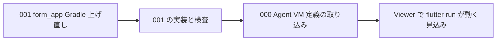

# 001 form_app の Android Gradle 構成を Flutter 3.50.1 向けに上げ直す

## 背景 (Background)

`form_app` はもともと Android（および他プラットフォーム）向けの Flutter サンプルである。本仕様で言う「上げ直し」は、アプリを Android 化することではない。`form_app/android/` のビルド構成（Gradle・Android Gradle Plugin・Kotlin Gradle Plugin、Groovy DSL）が古く、Agent VM に入れる Flutter 3.50.1 の最小版を満たさない問題を直すことである。

出どころ: `backlog:9710627d-5ac1-4ac1-b800-9a52889b1df0`（決着。方針2を採用し、Agent VM 定義の取り込み（[000-Kanban-AgentVM-Definition.md](prompts/phases/000-foundation/branches/chore-acs-bootstrap/ideas/000-Kanban-AgentVM-Definition.md)）より先に実施する）。

### いまの構成（main）

| 項目 | 値 |
| :--- | :--- |
| DSL | Groovy（`settings.gradle`、`build.gradle`、`app/build.gradle`） |
| Gradle Wrapper | 7.5 |
| AGP（`com.android.application`） | 7.3.0 |
| Kotlin（`buildscript` の classpath） | 1.7.10 |
| Java / JVM target | 1.8 |
| applicationId / namespace | `dev.flutter.formApp.form_app` |

### Flutter 3.50.1 が求める最小版とテンプレートの既定

Flutter 3.50.1 の `DependencyVersionChecker` は、次を下回ると例外でビルドを止める（警告の下限は括弧内）。

| 項目 | エラー下限 | 警告下限 | テンプレートの既定（`gradle_utils.dart`） |
| :--- | :--- | :--- | :--- |
| Gradle | 9.3.1 | 9.5.0 | 9.5.0 |
| AGP | 9.1.1 | 9.3.1 | 9.3.1 |
| Kotlin Gradle Plugin | 2.4.10 | 2.4.20 | 2.4.20 |
| Java（Gradle を動かす JVM） | 17 | 17 | 17 |

いまの `form_app` はエラー下限をすべて下回る。リポジトリ内で比較的新しい `cupertino_gallery`（AGP 8.9.1・Gradle 8.12・Kotlin 2.1.0）も、まだエラー下限に届かない。

Kanban のカード 3 件は、この上げ直しを途中まで行っていた（Gradle 9.5.0 への更新と、テンプレート由来の `android.newDsl=false` / `android.builtInKotlin=false`）。ただし新しい `.kts` が自動コミットに乗らず、カードのブランチでは Android 構成が欠けた状態で残っている。本仕様では、欠けた部分を含めて完全な構成を入れる。

### なぜ先にやるか

Agent VM 定義（000）を入れると、イメージの bake 自体は `flutter pub get` までなので通る。一方、Android Viewer の Flutter dev supervisor は `form_app` で `flutter run --machine -d emulator-5554 --debug` を実行する。構成を上げ直さないと Viewer の Hot Reload / Hot Restart / Rebuild が失敗する見込みである。定義を入れた直後から Viewer を使える状態に近づけるため、本仕様を 000 より先に実施する。

## 要件 (Requirements)

### 必須要件

- **R1 版の下限**: `form_app/android/` の構成が、Flutter 3.50.1 のエラー下限以上であること。採用する版はテンプレートの既定に合わせる。
  - Gradle Wrapper: **9.5.0**
  - AGP: **9.3.1**
  - Kotlin Gradle Plugin: **2.4.20**
  - Java / Kotlin JVM target: **17**
- **R2 Flutter 3.50.1 の Kotlin アプリ用テンプレートへ合わせる**: Groovy の `settings.gradle`・`build.gradle`・`app/build.gradle` をやめ、次の Kotlin DSL ファイルにする。中身は Flutter 3.50.1 のテンプレート（`packages/flutter_tools/templates/app/android.tmpl/` と `app/android-kotlin.tmpl/`）に合わせ、識別子だけ `form_app` の値を残す。
  - 新規または置換:
    - `form_app/android/settings.gradle.kts`
    - `form_app/android/build.gradle.kts`
    - `form_app/android/app/build.gradle.kts`
    - `form_app/android/gradle.properties`（テンプレートどおり。`android.newDsl=false` と `android.builtInKotlin=false` を含む。`android.enableJetifier` はテンプレートに無いので付けない）
    - `form_app/android/gradle/wrapper/gradle-wrapper.properties`（`gradle-9.5.0-all.zip`）
  - 削除:
    - `form_app/android/settings.gradle`
    - `form_app/android/build.gradle`
    - `form_app/android/app/build.gradle`
- **R3 識別子とソースの維持**:
  - `namespace` と `applicationId` は `dev.flutter.formApp.form_app` のままにする。
  - `MainActivity` は `form_app/android/app/src/main/kotlin/dev/flutter/formApp/form_app/MainActivity.kt` に置き、パッケージ名は変えない。本文はテンプレートに合わせて `class MainActivity : FlutterActivity()` としてよい。
  - アイコンや `res/` の既存リソースは消さない。
- **R4 AndroidManifest**: `app/src/main/AndroidManifest.xml` に、テンプレートと同じく `android:taskAffinity=""` と `<queries>`（`PROCESS_TEXT`）を足す。`android:label` は `form_app` のまま。debug / profile の Manifest は、差分がテンプレートと食い違うときだけ直す。
- **R5 `.gitignore`**: `form_app/android/.gitignore` をテンプレートに合わせる（`.cxx/` の追加、keystore コメントの URL 更新）。
- **R6 検査**: 構成が R1〜R2 を満たすことを確かめる検査を作り、`scripts/process/build.sh` から流す。Flutter SDK が無くても、ファイルの版と DSL の形は失敗できること。Flutter SDK がある環境では、追加で `form_app` の `flutter build apk --debug`（または同等）が成功することを同じ検査か隣接する手順で確かめる。
- **R7 範囲**: 変更は `form_app/android/` と、検査スクリプト（および `build.sh` からの呼び出し）に限る。他のサンプルの Android 構成は変えない。Agent VM 定義（`.kotoshiro/kanban/`）は本仕様では変えない。

### 任意要件

- **O1 Flutter があるときのビルド**: 手元または CI に Flutter 3.50.x と JDK 17 があるとき、`form_app` で `flutter pub get` のあと `flutter build apk --debug` が成功することを検査に含める。Flutter が無ければ、この部分だけを「前提不足」として失敗にするか、明示的なフラグでスキップするかを実装計画で決める。スキップする場合でも、R6 のファイル検査は飛ばさない。

### 対象外

- 他サンプル（`cupertino_gallery` など）の Gradle 上げ直し。
- Agent VM の `warmup/` への Gradle 依存の事前取得（000 側。必要なら kanban-demo の正本を先に直す）。
- Dart / Flutter のアプリコード（`form_app/lib/`）の変更。
- 上流への PR。このフォーク上の変更として扱う。

## 実現方針 (Implementation Approach)

### 目標のファイル構成

```text
form_app/android/
├── .gitignore
├── settings.gradle.kts          # AGP 9.3.1、Kotlin 2.4.20、flutter-plugin-loader
├── build.gradle.kts             # allprojects / clean（テンプレートどおり）
├── gradle.properties            # jvmargs、useAndroidX、newDsl=false、builtInKotlin=false
├── gradle/wrapper/gradle-wrapper.properties  # gradle-9.5.0-all.zip
└── app/
    ├── build.gradle.kts         # namespace / applicationId = dev.flutter.formApp.form_app、Java 17
    └── src/main/
        ├── AndroidManifest.xml  # taskAffinity と queries を追加
        └── kotlin/dev/flutter/formApp/form_app/MainActivity.kt
```

### `settings.gradle.kts`（要点）

Flutter 3.50.1 テンプレートと同じ構造にする。

```kotlin
plugins {
    id("dev.flutter.flutter-plugin-loader") version "1.0.0"
    id("com.android.application") version "9.3.1" apply false
    id("org.jetbrains.kotlin.android") version "2.4.20" apply false
}
```

`pluginManagement` で `local.properties` の `flutter.sdk` を読み、`includeBuild("$flutterSdkPath/packages/flutter_tools/gradle")` する点もテンプレートと同じにする。

### `app/build.gradle.kts`（要点）

- プラグインは `com.android.application` と `dev.flutter.flutter-gradle-plugin`（Kotlin 用テンプレートどおり。`kotlin-android` を app 側に書かない）。
- `namespace` / `applicationId` は `dev.flutter.formApp.form_app`。
- `compileSdk` / `minSdk` / `targetSdk` / `ndkVersion` / `versionCode` / `versionName` は `flutter.*` を使う。
- `compileOptions` は Java 17。`kotlin { compilerOptions { jvmTarget = JVM_17 } }` をテンプレートどおり置く。

### 古い Groovy の削除

`settings.gradle`・`build.gradle`・`app/build.gradle` を残すと Gradle がどちらを読むか曖昧になるため、Kotlin DSL を入れた同じ変更で削除する。

### 検査スクリプト

| ファイル | 役割 |
| :--- | :--- |
| `scripts/process/check_form_app_android.sh` | 入口。版とファイルの有無を確かめる。任意で Flutter ビルド |
| `scripts/process/lib/form_app_android_check.py` | `settings.gradle.kts`・wrapper・`app/build.gradle.kts` を読み、R1 の版と識別子を確かめる |
| `scripts/process/test/check_form_app_android_test.sh` | 壊した fixtures で検査が失敗することを確かめる自己試験 |

`scripts/process/build.sh` から、Go の手順のあとにこの検査（と自己試験）を呼ぶ。000 の Kanban 定義検査がまだ無い段階でも、本検査だけは流せるようにする。

検査が確かめること（例）:

1. Groovy の `settings.gradle` / `build.gradle` / `app/build.gradle` が無い。
2. `settings.gradle.kts` に AGP `9.3.1` と Kotlin `2.4.20` がある。
3. wrapper が `gradle-9.5.0-all.zip` を指す。
4. `app/build.gradle.kts` の `applicationId` / `namespace` が `dev.flutter.formApp.form_app`。
5. `gradle.properties` に `android.newDsl=false` と `android.builtInKotlin=false` がある。
6. Manifest に `taskAffinity` と `PROCESS_TEXT` の queries がある。

### 000 との順序



本仕様の完了後に、000 の実装（`/execute-all-after-spec` など）へ戻る。

## 検証シナリオ (Verification Scenarios)

1. `form_app/android/` を Flutter 3.50.1 テンプレート相当の Kotlin DSL に置き換え、Groovy の 3 ファイルを削除する。
2. `scripts/process/build.sh` を流す。`form_app` Android の検査と自己試験が成功する。
3. 自己試験で、次を壊すと検査が失敗することを確かめる。
   1. AGP を `8.9.1` に戻すと失敗する。
   2. Gradle wrapper を `8.12` に戻すと失敗する。
   3. Kotlin を `2.1.0` に戻すと失敗する。
   4. Groovy の `settings.gradle` を残すと失敗する。
   5. `applicationId` を別の値にすると失敗する。
4. （O1・Flutter があるとき）`form_app` で `flutter pub get` のあと `flutter build apk --debug` が成功する。DependencyVersionChecker の例外が出ない。
5. `git diff --name-only` に、`form_app/android/` と検査スクリプト以外のサンプルディレクトリが出ない。

## テスト項目 (Testing for the Requirements)

| 要件 | 確かめ方 |
| :--- | :--- |
| R1〜R5 | `scripts/process/check_form_app_android.sh` と自己試験 |
| R6 | `scripts/process/build.sh` が上記検査を呼ぶ |
| R7 | 変更ファイル一覧の確認（シナリオ 5） |
| O1 | Flutter があるとき `flutter build apk --debug` |

### ビルド・全体検証

1. ビルドと検査:

   ```bash
   scripts/process/build.sh
   ```

2. form_app Android 検査だけ:

   ```bash
   scripts/process/check_form_app_android.sh
   scripts/process/test/check_form_app_android_test.sh
   ```

3. 統合試験は本変更では流さない。`scripts/process/integration_test.sh` は `tests/go.mod` が無いと何も流さず、`--categories` にも対応していない。Android の構成確認は上記の検査スクリプトで行う。Agent VM 上での `flutter run` は、000 取り込み後の受け入れで確かめる。
