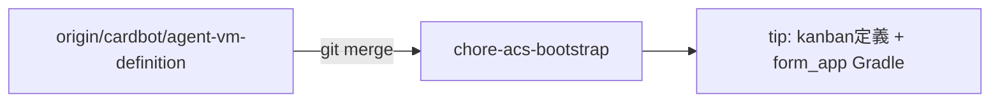

# 002 `cardbot/agent-vm-definition` を本ブランチへ merge する

## 背景 (Background)

調査（`tmp/investigate/2026-11-28-branch-compare-agent-vm-definition.md`、リポジトリには含まれない）の結果、次が分かっている。

| ブランチ | tip（調査時点） | 持つもの |
| :--- | :--- | :--- |
| `cardbot/agent-vm-definition` | `5d9d3aa9` | `.kotoshiro/kanban/`（Agent VM 定義 7 ファイル） |
| `chore-acs-bootstrap`（本ブランチ） | form_app Gradle 上げ直しと仕様 000/001 | tip 上に `.kotoshiro/kanban/` が無い |

どちらも `main`（`a5bccd24`）から分岐しており、互いに相手のコミットを含まない。本ブランチだけで Kanban ボードを作ると `lane_templates.yaml` が無く Pin bake が止まる。定義ブランチだけだと Gradle が古いままで Viewer の `flutter run` が失敗する見込みである。

仕様 [000-Kanban-AgentVM-Definition.md](prompts/phases/000-foundation/branches/chore-acs-bootstrap/ideas/000-Kanban-AgentVM-Definition.md) は、取り込み方法として `git merge origin/cardbot/agent-vm-definition` を既に定めている。本仕様はその **merge 作業そのもの**を対象にし、運用上の範囲を次のように限る。

- **する**: 本ブランチ（`chore-acs-bootstrap`）へ定義ブランチを merge し、定義 7 ファイルを tip に載せる。
- **しない**: リモートの `cardbot/agent-vm-definition` を削除する、本ブランチへ強制的に一本化する、PR で定義ブランチを閉じる、といった「1 本化」運用。定義ブランチは残してよい。

## 要件 (Requirements)

### 必須要件

- **R1 merge**: 作業ブランチ `chore-acs-bootstrap` で `origin/cardbot/agent-vm-definition` を merge する。ファイルの手コピーや cherry-pick は使わない（blob・tree・ファイルモード 100755 を保つため。仕様 000 と同じ理由）。
- **R2 tip の確認**: merge 後の HEAD に、定義ブランチと同じ 7 ファイルがある。blob ID とモードが `5d9d3aa9`（または merge 時点の `origin/cardbot/agent-vm-definition` tip）と一致する。
  - `.kotoshiro/kanban/lane_templates.yaml`
  - `.kotoshiro/kanban/agent-vm/image.yaml`
  - `.kotoshiro/kanban/agent-vm/install/10-flutter-sdk.sh`
  - `.kotoshiro/kanban/agent-vm/install/20-android-sdk.sh`
  - `.kotoshiro/kanban/agent-vm/install/30-emulator.sh`
  - `.kotoshiro/kanban/agent-vm/verify/10-flutter-doctor.sh`
  - `.kotoshiro/kanban/agent-vm/warmup/10-pub-get.sh`
- **R3 既存成果を壊さない**: merge により、本ブランチの form_app Gradle 上げ直し（仕様 001）と、その検査スクリプトが消えない・巻き戻らない。
- **R4 定義ハッシュ**: merge 後の `.kotoshiro/kanban/agent-vm/` について、Kanban と同じ式  
  `sha256("image.yaml=<blob>|install=<tree>|verify=<tree>")`  
  が `08d135fe9c9fb355d2c9028cd65039d072dff675b37de46f60e451a5c82ef82d` である（定義 tip が `5d9d3aa9` のままである場合）。tip が進んでいた場合は、正本との一致を確かめたうえで期待値を更新する判断を仕様 000 に従う。
- **R5 1 本化しない**: リモートの `cardbot/agent-vm-definition` を削除しない。本ブランチへの強制的な一本化（定義ブランチの廃止）をこの変更の完了条件にしない。
- **R6 検査**: merge 後に `scripts/process/build.sh` が成功する（少なくとも form_app Android 検査が通る）。未コミットの ACS 一式（`.cursor/` や `prompts/manifest/` など）は、この merge コミットに含めない。

### 任意要件

- **O1**: merge コミットを `origin/chore-acs-bootstrap` へ push する（ユーザーが明示したとき、または本仕様の実施指示に push が含まれるとき）。

### 対象外

- 仕様 000 全体（検査スクリプト新設、`.gitattributes` の `eol=lf`、O1 の kanban-demo 突き合わせなど）。それらは 000 の実装として別途行う。
- `cardbot/agent-vm-definition` の削除・改名・PR クローズ。
- form_app 以外のサンプルの Gradle 変更。

## 実現方針 (Implementation Approach)



1. `git fetch origin cardbot/agent-vm-definition` で tip を確認する。`5d9d3aa9` から進んでいれば、仕様 000 の R2（正本と同じか）を確かめてから merge する。
2. 作業ツリーの未追跡 `.kotoshiro/tokotachi/` などがあっても、merge が追加するのは `.kotoshiro/kanban/` なのでパスは重ならない。衝突したら未追跡を退避してから再実行する。
3. `git merge origin/cardbot/agent-vm-definition`（マージコミットを作る。ff のみに限定しない。履歴に定義コミットが残ることを優先する）。
4. `git ls-tree -r HEAD -- .kotoshiro/kanban` で blob / モードを確認する。
5. 定義ハッシュを計算して R4 を満たすことを確認する。
6. `scripts/process/build.sh` を実行する。
7. 必要なら push（O1）。

## 検証シナリオ (Verification Scenarios)

1. `git fetch origin cardbot/agent-vm-definition` のあと、`git rev-parse origin/cardbot/agent-vm-definition` が分かる。
2. `git merge origin/cardbot/agent-vm-definition` が成功する（コンフリクトなし、または解消済み）。
3. `git ls-tree -r HEAD -- .kotoshiro/kanban` の 7 パスが揃い、`install/*.sh` 等が mode `100755` である。
4. 定義ハッシュが期待値（tip が `5d9d3aa9` なら `08d135fe…`）と一致する。
5. `form_app/android/settings.gradle.kts` に AGP `9.3.1` が残っている（本ブランチの Gradle 上げ直しが消えていない）。
6. `scripts/process/build.sh` が成功する。
7. リモートの `origin/cardbot/agent-vm-definition` が、この作業の結果として削除されていない。

## テスト項目 (Testing for the Requirements)

| 要件 | 確かめ方 |
| :--- | :--- |
| R1〜R2 | `git log` / `git ls-tree` |
| R3 | `git show HEAD:form_app/android/settings.gradle.kts` に AGP 9.3.1 |
| R4 | 定義ハッシュ計算（下記） |
| R5 | `git ls-remote --heads origin cardbot/agent-vm-definition` が残る |
| R6 | `scripts/process/build.sh` |

### ビルド・全体検証

1. ビルド＋ form_app 検査:

   ```bash
   scripts/process/build.sh
   ```

2. 定義の存在確認（読み取り）:

   ```bash
   git ls-tree -r HEAD -- .kotoshiro/kanban
   ```

3. 統合試験は流さない。`integration_test.sh` は本リポジトリでは実質 no-op であり、本変更の影響範囲外である。
